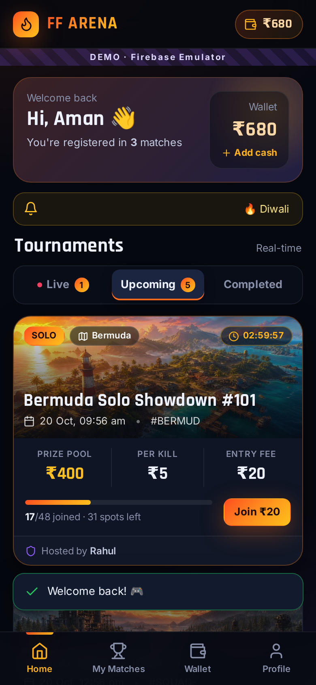
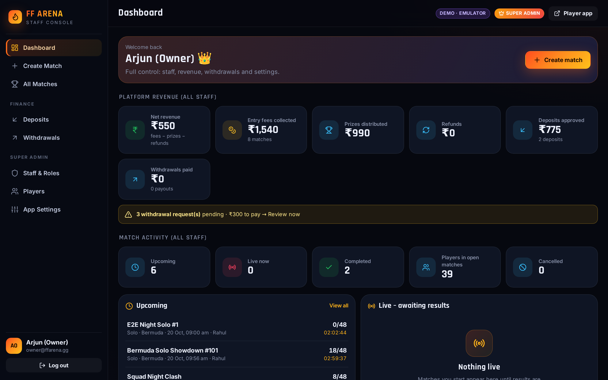

# 🔥 FF Arena – Paid Free Fire Tournament Platform

**Player App** (Android APK via HopWeb/Cordova, or web) + **Multi-Admin Staff Console** for a
Super Admin and 10–15 co-admins. Built on **Firebase Auth + Cloud Firestore** with strict
Security Rules. It runs on the **free Spark plan**.

| Player app | Staff console |
|---|---|
|  |  |

---

## ✅ What's included

**1. Database & multi-admin**
- Roles in `/staff/{uid}`: `super` and `staff`, with an `active` switch and a `perms.deposits` flag.
- Each match is auto-tagged with `hostId` (admin_id) and `hostName` (staff_name). The rules reject spoofed tags.
- Staff manage only their own matches. The Super Admin sees and controls everything.

**2. Staff panel** (`admin.html`)
- Secure staff login. Accounts that aren't staff or are deactivated are refused.
- Create Match: title, date/time, entry fee, prize pool, per-kill bonus, Solo/Duo/Squad, map, total slots. Also a rank-prize builder, live preview and an economics calculator.
- Manage Matches: filtered to the logged-in staff member (the Super Admin can filter by staff).
- Room ID and password: unlocks 15 minutes before start (enforced by rules). Only joined players can read it.
- Result upload: kills + rank per player. Winnings = `kills × perKill + rankPrize`, credited to winning balances automatically, idempotent, with prize-pool caps.
- Go live, cancel & refund everyone (to the exact balance they paid from), CSV export.
- Super Admin: revenue dashboard, staff performance, staff & roles (create logins without logging out), withdrawals, deposits, players (ban, wallet adjust), app settings.

**3. Player app** (`index.html`)
- Sign up, login, forgot password (email link **or** mobile OTP).
- Dashboard with Live / Upcoming / Completed tabs, all updating in real time.
- Join: pick a slot (team rows A–D for Duo/Squad), enter IGN + Free Fire Player ID, and the entry fee is deducted atomically (deposit balance first, then winning).
- Wallet: deposit + winning balances and a full ledger. Add money by UPI intent/QR + UTR, with Razorpay and TournaPay hooks. Withdraw to UPI, Paytm, PhonePe or GPay.
- Match page: prize table, room details, joined players, results. Plus My Matches and Profile.

**4. Security & concurrency**
- Firestore transactions with create-only slot locks, so there's **no double booking**, even at the same millisecond.
- Players can never add money to their own wallet. Every wallet change is recalculated by the rules from a paired "reason" document (see [docs/ARCHITECTURE.md](docs/ARCHITECTURE.md#4-money-invariants-enforced-by-firestorerules)).
- **24 automated tests** cover rules + concurrency (`npm test`), plus a full browser E2E test.

---

## 🧪 Demo accounts (emulator demo)

| Role | Email | Password |
|---|---|---|
| Super Admin | `owner@ffarena.gg` | `Owner@123` |
| Staff | `rahul.staff@ffarena.gg` · `priya.staff@ffarena.gg` | `Staff@123` |
| Player | `player1@ffarena.gg` (₹500 + ₹180) · `player2@…` · `player3@…` | `Player@123` |

The demo OTP number is Aman's mobile, `9876543210`. In demo mode the OTP is shown on screen.

---

## 📁 Project structure

```
ff-tournament-app/
├── firestore.rules            ★ security rules = the backend (roles, wallet maths, slot locks, prize formula)
├── firestore.indexes.json     composite indexes for every query
├── firebase.json / .firebaserc
├── public/                    static shell → copied to www/
│   ├── index.html             player app shell
│   ├── admin.html             staff console shell
│   ├── firebase-config.js     ★ YOUR Firebase keys (runtime, no rebuild needed)
│   └── assets/                icon + AI-generated map banners
├── src/
│   ├── shared/                config, firebase init, router, store, dom (XSS-safe html``), ui kit,
│   │                          icons, formatters, constants, prize.js (★ prize formula)
│   ├── services/              ALL Firebase logic (screens never touch Firestore directly)
│   │   ├── auth.service.js        signup/login/reset, phone OTP recovery
│   │   ├── match.service.js       listings + ★ joinMatch() transaction
│   │   ├── wallet.service.js      ledger, withdraw (hold), UPI/UTR deposit
│   │   ├── payment.service.js     gateway registry, UPI intent, Razorpay/TournaPay hooks
│   │   ├── user.service.js        profile + app config
│   │   └── admin/                 staff, admin-match (room/cancel/refund), result (payouts), finance, config
│   ├── player/                main.js, layout, screens/ (login, signup, forgot, home, match-detail,
│   │                          join-match, my-matches, wallet, add-money, withdraw, profile), components/
│   ├── admin/                 main.js, layout, screens/ (login, setup, dashboard, create-match, matches,
│   │                          match-manage, finance, staff, users, settings), components/
│   └── styles/                base.css (design system), match-card.css, player.css, admin.css
├── functions/                 OPTIONAL Cloud Functions (Blaze): Razorpay order/verify/webhook, TournaPay template
├── scripts/                   build.mjs (esbuild), serve.mjs (dev server + emulator proxy), seed.mjs (demo data)
├── tests/                     rules.test.mjs (24 security/concurrency tests), e2e.smoke.mjs (Playwright)
├── mobile/cordova/config.xml  Cordova template (https scheme, UPI intents)
├── docs/                      ARCHITECTURE.md + screenshots
└── www/                       ★ BUILD OUTPUT – deploy this / zip this for HopWeb
```

---

## 🚀 Run the demo locally (no Firebase account needed)

Requirements: Node 20+, Java 21 (for the Firestore emulator).

```bash
npm install
npm run build                 # src → www/
npm run emulators             # terminal 1: Auth + Firestore emulators
npm run seed                  # terminal 2: demo staff, players, 7 matches, wallets
npm run serve -- --demo       # http://localhost:3000  (player)  ·  /admin.html (staff)
npm test                      # 24 rules + concurrency tests (spins up its own emulators – stop terminal 1 first)
```

---

## 🔌 Connect your own Firebase project (production)

1. **Create a project** at [console.firebase.google.com](https://console.firebase.google.com) and add a **Web app**.
2. **Authentication → Sign-in method**: enable **Email/Password**. For OTP recovery, also enable **Phone** (SMS needs the Blaze plan).
3. **Firestore Database → Create** (region `asia-south1` Mumbai, production mode).
4. Paste the web config into `public/firebase-config.js`, or straight into `www/firebase-config.js` after building.
5. In `firestore.rules`, put **your** email in `isBootstrapOwner()` (search for `owner@ffarena.gg`).
6. Deploy:
   ```bash
   npm i -g firebase-tools && firebase login
   firebase use --add            # choose your project
   npm run build
   firebase deploy --only firestore:rules,firestore:indexes,hosting
   ```
7. Open `https://<project>.web.app/admin.html`, log in with your bootstrap email (create it from the player app sign-up first) → **Claim Super Admin**.
8. **App Settings**: set your merchant UPI ID, limits and announcement. **Staff & Roles**: add your co-admins.

---

## 📱 Convert to an Android APK

**Option A – HopWeb (easiest)**
- **URL mode (recommended):** deploy to Firebase Hosting and give HopWeb `https://<project>.web.app`. App updates go live without a new APK, and OTP/reCAPTCHA works.
- **Offline asset mode:** zip the **contents** of `www/` and import them. The bundles are classic scripts, so they run from `file://`. Phone OTP needs an https origin, so use email reset in this mode.
- Make sure the HopWeb project allows **DOM storage / IndexedDB** and **external intents** (`upi://`).

**Option B – Cordova**
```bash
npm i -g cordova
cordova create ffarena-apk com.ffarena.app "FF Arena" && cd ffarena-apk
rm -rf www && cp -r ../ff-tournament-app/www ./www
cp ../ff-tournament-app/mobile/cordova/config.xml ./config.xml
cordova platform add android && cordova plugin add cordova-plugin-inappbrowser
cordova build android --release
```
The admin console is meant for the web (`/admin.html`) on a laptop or phone browser.

---

## 💳 Payments

| Gateway | Plan | How it credits |
|---|---|---|
| **UPI intent + QR + UTR** (default) | Spark | The player pays to your UPI ID and submits the UTR. An admin verifies it in the bank app and approves. Each UTR can be used only once. |
| **Razorpay** | Blaze | `functions/index.js`: order, then HMAC-verified callback, plus a webhook backup. Idempotent credit. |
| **TournaPay / others** | Blaze | Template in `functions/index.js` (`createTournaPayOrder`, `tournapayWebhook`). |

Turn gateways on or off in **App Settings**. The wallet is **never** credited by client code for gateway payments.

---

## 🔐 Security model (short)

- Players can only spend their own money, and only through valid joins and withdrawal holds.
- Staff can only credit amounts that match the prize formula, once per player, for real participants, inside the prize-pool cap.
- Staff can't touch settings, roles, other staff's matches or withdrawals.
- Details are in [docs/ARCHITECTURE.md](docs/ARCHITECTURE.md). Proof is in `tests/rules.test.mjs`.

---

## ⚖️ Compliance note (India)

The **Promotion and Regulation of Online Gaming Act, 2025** (rules notified April 2026) bans
*online money games*. Paid-entry contests with cash prizes are generally covered, unless they
qualify as **recognised & registered e-sports** under the Act, which allows participation fees
and performance-based prizes. The Act is being challenged in the Supreme Court. **Get legal advice
before collecting real money.** The platform also works with free entry (entry fee ₹0). Google
Play also restricts real-money gaming apps.

---

## 🗣️ Hinglish quick guide

1. `npm install` → `npm run build` → `npm run emulators` → `npm run seed` → `npm run serve -- --demo`
2. Player app: `localhost:3000` · Staff panel: `localhost:3000/admin.html`
3. Apna Firebase: config `www/firebase-config.js` me paste karo, rules me apna email daalo, `firebase deploy`.
4. APK: HopWeb me hosted URL do (best), ya `www/` folder ka zip upload karo.
5. Staff add karna: Super Admin login → **Staff & Roles → Add staff** (max 15, Settings me change ho sakta hai).
